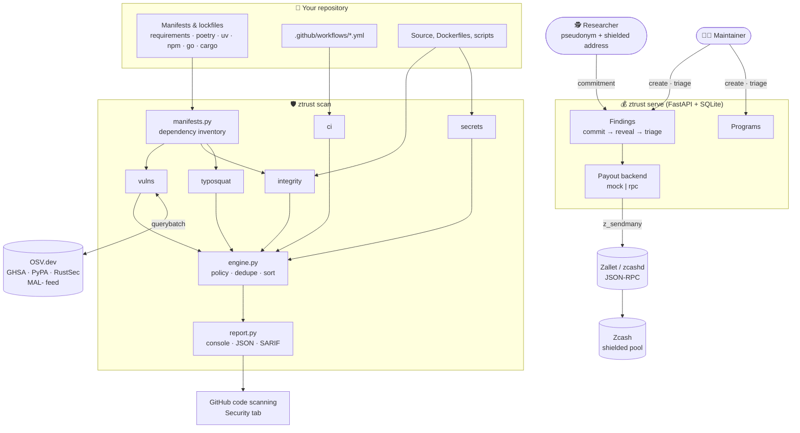
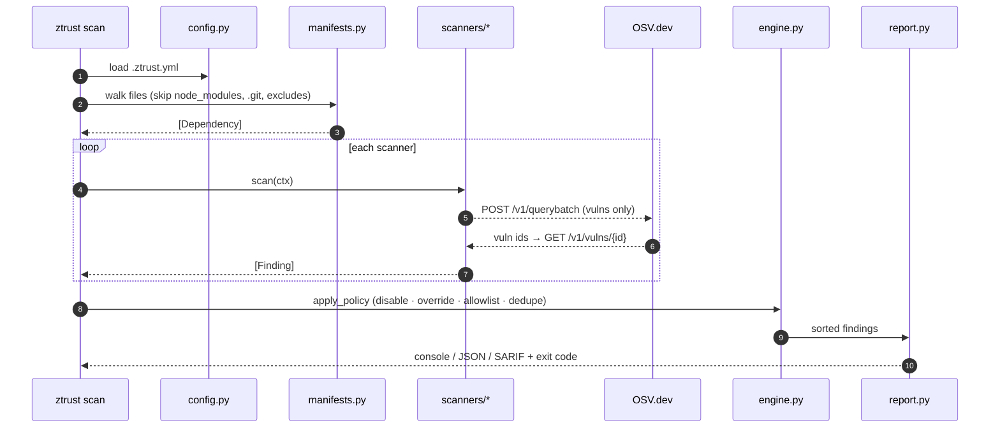

# Architecture

ZTrust has two halves that share one data model:

1. **Detection** — a stateless CLI / GitHub Action that turns a repository into a list of
   `Finding`s.
2. **Incentives** — a small API that lets maintainers fund bounties and lets independent
   researchers get paid in shielded ZEC for findings the scanner *cannot* make on its own.

## Scan pipeline

A failing scanner never hides the others: its exception becomes a warning in the report.
Network failures in the OSV scanner degrade to a warning as well, so the CLI is safe to
run in air-gapped CI with `--offline`.

## Module map

| Module | Responsibility |
|---|---|
| `models.py` | `Severity`, `Category`, `Dependency`, `Finding`, `ScanResult` |
| `config.py` | `.ztrust.yml` loading, exclude globs, rule toggles |
| `manifests.py` | Parsers for 7 manifest / lockfile formats |
| `scanners/base.py` | `Scanner` ABC, `ScanContext` (file walk, safe text reads) |
| `scanners/secrets.py` | 13 provider patterns + entropy heuristic, redaction |
| `scanners/typosquat.py` | Damerau-Levenshtein, separator and homoglyph checks |
| `scanners/integrity.py` | Pinning, hashes, sources, install scripts, `curl \| sh` |
| `scanners/cicd.py` | GitHub Actions hardening |
| `scanners/vulns.py` | OSV client, CVSS v3 calculator |
| `engine.py` | Orchestration and policy |
| `report.py` | Rich console, JSON, SARIF 2.1.0 |
| `bounty/zcash.py` | Amounts, Bech32/Bech32m, Base58Check, ZIP-321 |
| `bounty/protocol.py` | Commit-reveal |
| `bounty/store.py` | SQLite persistence |
| `bounty/backends.py` | Mock and JSON-RPC payout backends |
| `server/app.py` | REST API |
| `cli.py` | `scan`, `deps`, `commit`, `pay-uri`, `check-address`, `serve` |

## Design principles

- **Zero trust in inputs.** Manifests, workflow files and research reports are attacker-controlled.
  Parsing uses `yaml.safe_load`, `json`, `tomllib`; nothing is executed.
- **Few dependencies.** The scanner needs only `rich` and `PyYAML`; Zcash primitives are pure Python.
  A supply-chain tool with a huge supply chain would be ironic.
- **Every finding is actionable.** A rule without a remediation is not merged.
- **Privacy by default for people, transparency for money.** Researchers are pseudonymous and paid
  through shielded transactions; program funding can be made auditable with a viewing key.
