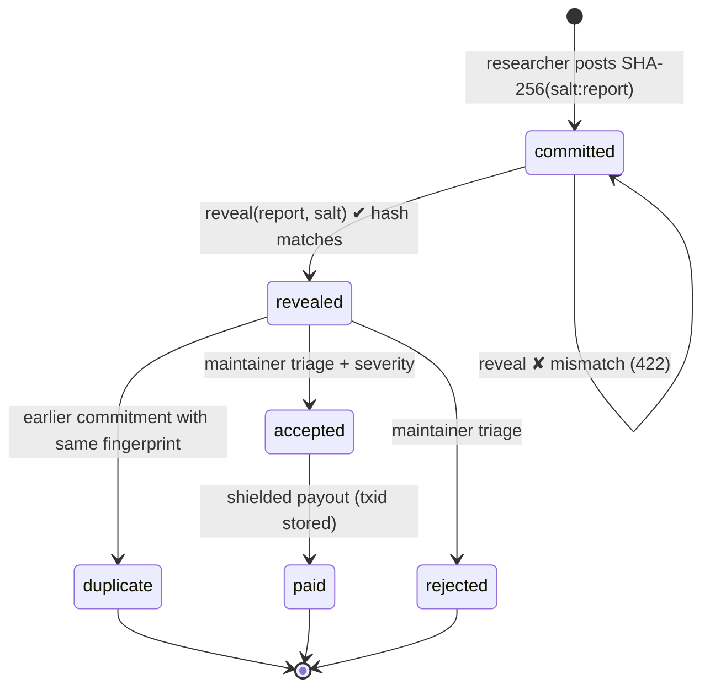
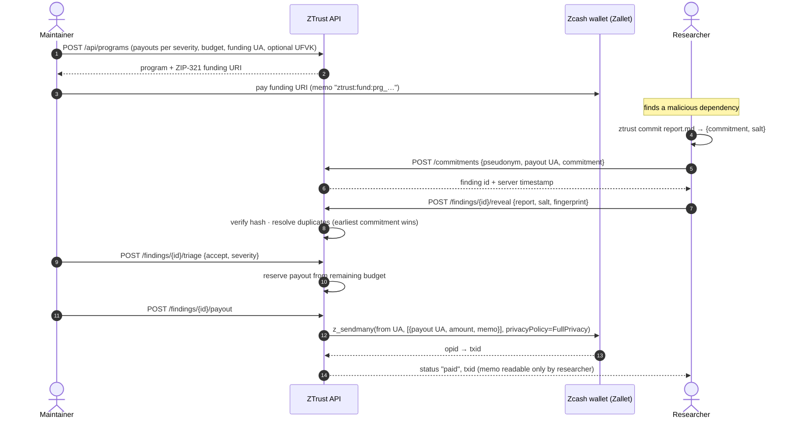

# Bounty protocol

Scanners find *known* problems. The xz-utils backdoor, poisoned GitHub Actions and
npm worms were found by **people** — usually unpaid volunteers. ZTrust turns that
work into a market with three properties:

| Property | How |
|---|---|
| **Researchers stay anonymous** | Pseudonym + shielded Zcash address. No KYC, no e-mail, no bank account. |
| **Nobody can steal a finding** | Commit-reveal: the timestamped hash proves who found it first, before anyone sees it. |
| **Money is verifiable, payments are private** | Pools can publish a viewing key; payouts are shielded `z_sendmany` with an encrypted memo. |

## Lifecycle



## End-to-end sequence



## Commitment format

```
commitment = hex( SHA-256( salt_hex || ":" || report_bytes ) )
salt_hex   = 32–128 lowercase hex chars (ztrust commit uses 64)
```

The salt prevents brute-forcing short or guessable reports from the hash. Keep the salt
secret until you reveal.

```bash
$ ztrust commit report.md
{
  "commitment": "4b1c…e9",
  "salt": "a3f0…71",
  "report_bytes": 1832
}
```

## Duplicate resolution

At reveal time the researcher supplies a `fingerprint` — a CVE / OSV id, a ZTrust finding
fingerprint, or any stable identifier agreed by the program. Among findings with the same
fingerprint **the one with the earliest commitment wins**, regardless of reveal order. This
removes the incentive to rush half-baked reports and stops a malicious triager from quietly
re-submitting a researcher's work under another name.

## Budget accounting

```
remaining = budget − spent − reserved
reserved  = Σ payout of findings in state "accepted"
```

A finding can only be accepted if its payout fits in `remaining`, so a program can never
promise more ZEC than it committed.

## Suggested payout table

| Severity | Typical issue | Suggested reward |
|---|---|---|
| critical | Malicious package, stolen publish token, pwn-request in release workflow | 2 – 10 ZEC |
| high | Script injection in CI, typosquat in build deps, leaked deploy key | 0.5 – 2 ZEC |
| medium | Unpinned third-party action with secrets, git-sourced dependency in release | 0.1 – 0.5 ZEC |
| low | Missing token permissions, hygiene | thanks / swag |

## Threats to the protocol itself

See [threat-model.md](threat-model.md#bounty-platform).
