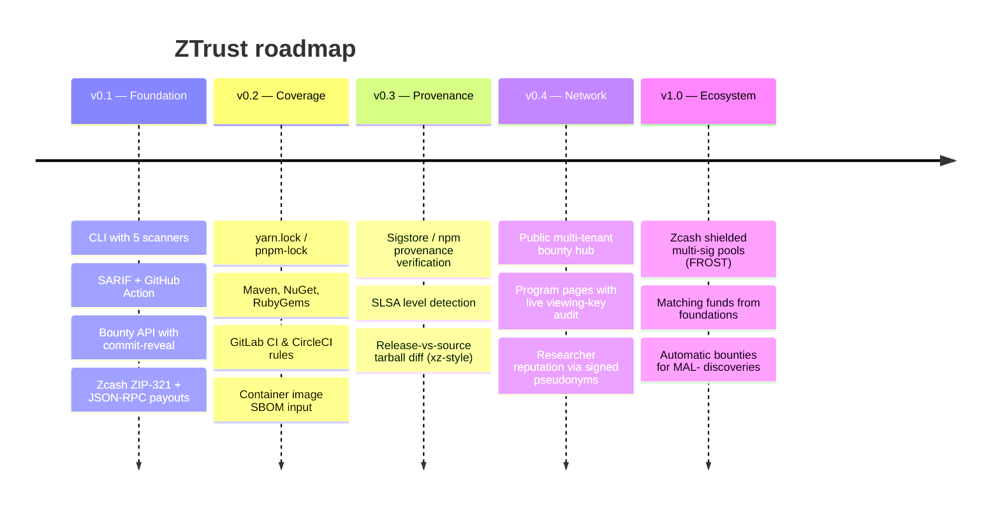

# Roadmap

## Ideas under discussion

- **Auto-bounties**: when a researcher's report leads to a new `MAL-` OSV entry affecting a
  participating program, pay a pre-agreed reward automatically.
- **FROST multisig pools** so no single maintainer can spend the bounty pool alone.
- **Shielded donations** from users of a project directly into its security pool via a
  ZIP-321 link in the README badge.
- **Encrypted reports**: researchers encrypt the reveal to the maintainer's public key, so the
  server never sees plaintext.

Have an idea? Open an issue with the *New detection rule* or *feature* template.
