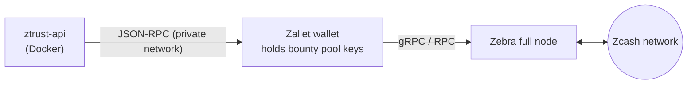

# Why Zcash, and how ZTrust uses it

## Why not a bank transfer, PayPal or a transparent chain?

Security researchers who look at supply chains often live in jurisdictions that payment
processors don't serve, prefer not to tie their legal identity to "found a backdoor in X",
or simply don't want every payment they ever received to be public. On a transparent
blockchain the payout address of a known researcher becomes a permanent, linkable record.

Zcash shielded transactions encrypt **sender, recipient, amount and memo** on-chain, while
still giving cryptographic finality and global reach. Viewing keys provide *selective*
transparency: a project can prove its bounty pool is funded without exposing who was paid.

| Need | Zcash feature | Spec |
|---|---|---|
| Private payouts | Shielded pools (Orchard, Sapling) | [Protocol spec](https://zips.z.cash/protocol/protocol.pdf) |
| One address for all pools | Unified Addresses | [ZIP-316](https://zips.z.cash/zip-0316) |
| Payment links / QR codes | Payment request URIs | [ZIP-321](https://zips.z.cash/zip-0321) |
| Attach finding id to payment | 512-byte encrypted memo | [ZIP-302](https://zips.z.cash/zip-0302) |
| Predictable fees | Proportional transfer fee | [ZIP-317](https://zips.z.cash/zip-0317) |
| Auditable funding | Unified Full Viewing Keys | [ZIP-316](https://zips.z.cash/zip-0316) |

## What ZTrust implements in pure Python

- **Amounts** in zatoshis (`1 ZEC = 100 000 000 zat`) with strict 8-decimal validation.
- **Address validation** with real checksums:
  - Base58Check transparent addresses (`t1`, `t3`, testnet `tm`, `t2`);
  - Bech32 Sapling (`zs1…`);
  - Bech32m Unified (`u1…`) and TEX (`tex1…`, [ZIP-320](https://zips.z.cash/zip-0320)) — without the
    BIP-173 90-character limit, because Unified Addresses are longer.
- **ZIP-321 URIs**: `zcash:<addr>?amount=…&memo=<base64url>&label=…&message=…`.
  Memos are refused for transparent recipients, as the ZIP requires.
- **Viewing key recognition** (`uview1…`, `zxviews1…`).

Payout addresses must be **shielded** (Unified or Sapling) and on the server's network.

```bash
$ ztrust check-address u1...
{"valid": true, "kind": "unified", "network": "main", "shielded": true}

$ ztrust pay-uri --address u1... --amount 2.5 --memo "ztrust:fund:prg_abc"
zcash:u1...?amount=2.5&memo=enRydXN0OmZ1bmQ6cHJnX2FiYw
```

## Payout backends

| `ZTRUST_ZCASH_BACKEND` | Behaviour |
|---|---|
| `mock` (default) | Deterministic fake txids. For development and tests — never moves funds. |
| `rpc` | zcashd-compatible JSON-RPC: `z_sendmany` → poll `z_getoperationstatus`. |

The `rpc` backend targets the JSON-RPC interface that **zcashd** exposed and that
**[Zallet](https://github.com/zcash/wallet)** — the Rust wallet replacing the deprecated zcashd —
implements for compatibility. Pair it with a **[Zebra](https://github.com/ZcashFoundation/zebra)** full node.

```text
z_sendmany "<ZTRUST_ZCASH_FROM_ADDRESS>"
           [{"address": "<researcher UA>", "amount": 2.0, "memo": "<hex>"}]
           1          # minconf
           null       # fee → ZIP-317 default
           "FullPrivacy"
```

`FullPrivacy` makes the wallet refuse any transaction that would reveal amounts or
addresses. If the pool and the researcher's address are in different shielded pools you
may need `AllowRevealedAmounts`; set `ZTRUST_ZCASH_PRIVACY_POLICY` accordingly.

### Recommended deployment



- Run the wallet on a separate host; the API only needs RPC access to one account.
- Keep only the current budget in the hot wallet; top up from cold storage.
- Publish the pool's UFVK in the program so anyone can audit incoming funds.
- Use testnet (`ZTRUST_ZCASH_NETWORK=test`, `utest1…` addresses) first. Testnet ZEC is free from community faucets.

## Further reading

- Zcash documentation: <https://zcash.readthedocs.io/>
- ZIP index: <https://zips.z.cash/>
- Zallet: <https://github.com/zcash/wallet>
- Zebra: <https://github.com/ZcashFoundation/zebra>
